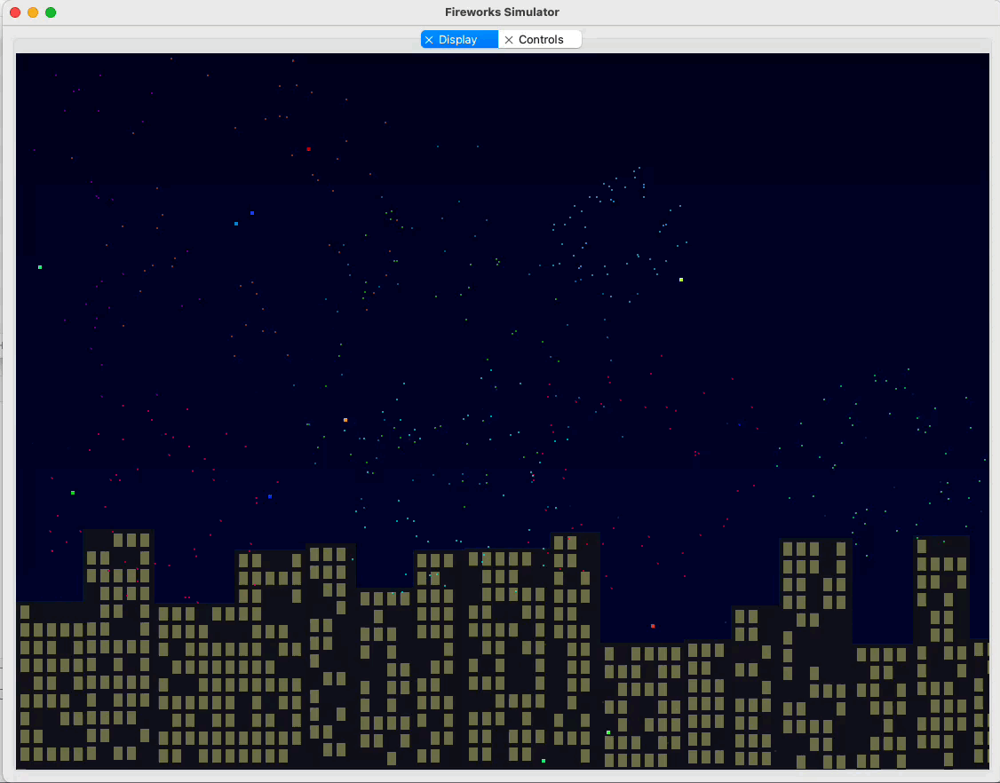
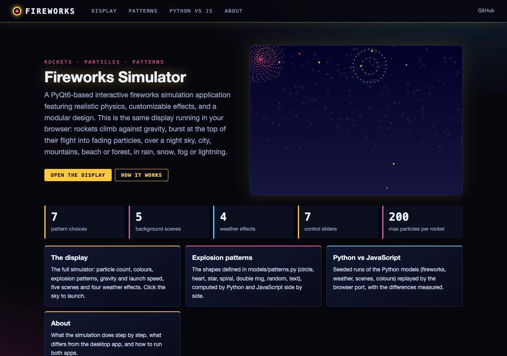
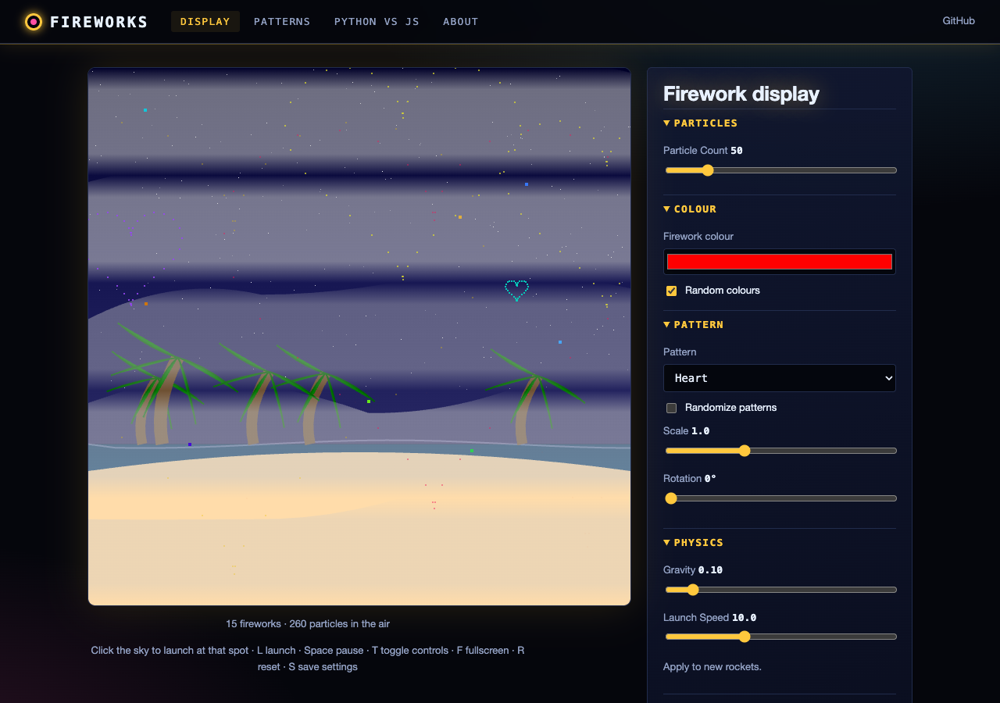
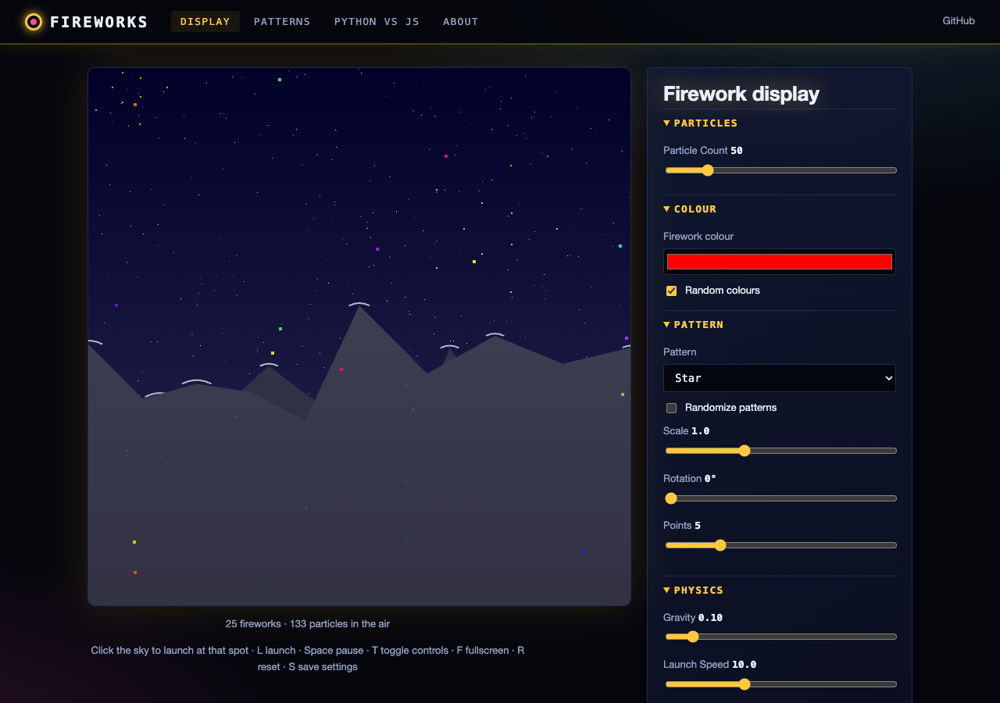
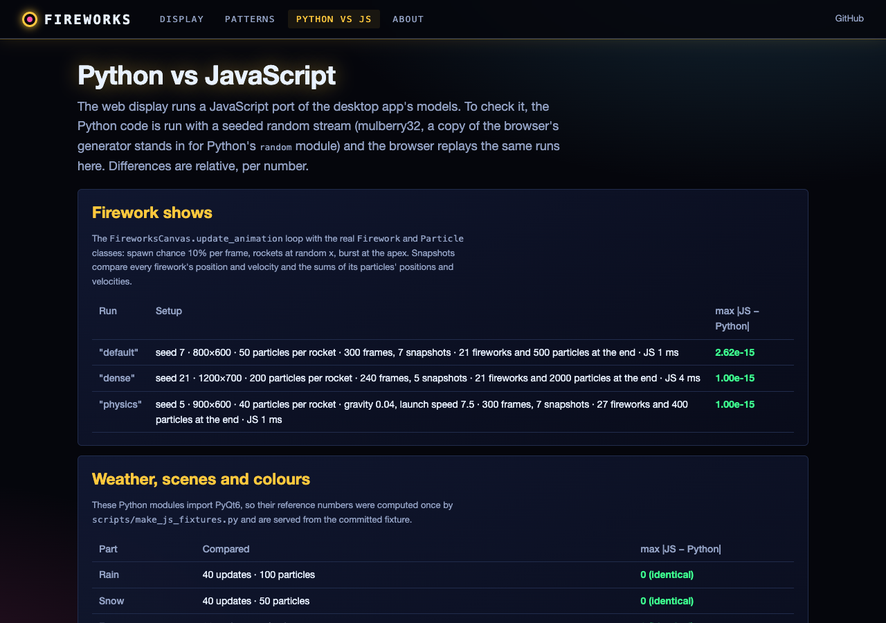

# Fireworks Simulator

A PyQt6-based interactive fireworks simulation application featuring realistic physics, customizable effects, and a modular design.



## Features

### Firework Effects
- Realistic particle physics simulation
- Customizable particle count and colors
- Explosion pattern shapes (`models/patterns.py`), selectable in the control panel:
  - Circle
  - Heart
  - Star (customizable points)
  - Spiral (adjustable arms)
  - Double Ring
  - Text (A-Z and 0-9 as 5 x 7 dot-matrix glyphs, `models/glyphs.py`)
- Random pattern generation
- Adjustable scale and rotation for patterns
- Each pattern point becomes one particle, so the burst grows into the shape (the outermost point moves at the
  maximum particle speed times the pattern scale)
- Adjustable gravity and launch speed for new rockets

### Weather Effects
- Rain (intensity parameter in `RainEffect`, not in the control panel)
- Snow with wind effects
- Dynamic fog with layered opacity
- Lightning with realistic branching

### Backgrounds
- Night sky with stars
- Cityscape with illuminated windows
- Mountain range with snow caps
- Beach scene with animated waves
- Forest with fireflies

### User Interface
- Detachable display and control panels
- Real-time parameter adjustment
- Customizable launch controls
- Pattern randomization options
- Intuitive color selection

## Installation

### Prerequisites
- Python 3.11 or higher
- PyQt6

### Basic Installation
1. Clone the repository:
```bash
git clone https://github.com/gddickinson/fireworks.git
cd fireworks
```

2. Create and activate a virtual environment (recommended):
```bash
python -m venv venv
source venv/bin/activate  # On Windows: venv\Scripts\activate
```

3. Install required packages:
```bash
pip install -r requirements.txt
```

### Running the Application
```bash
python main.py
```

## Web version

The display also runs in the browser: **https://gddickinson.github.io/fireworks/** (GitHub Pages, published from
`main` by `.github/workflows/pages.yml`). It is a JavaScript port of the models (rockets, particles, patterns,
weather, scenes) with the same controls, checked number for number against seeded runs of the Python code.

| | |
|---|---|
|  |  |
|  |  |

Pages: **Display** (the simulator; click the sky to launch, L launch, Space pause, T controls, F fullscreen,
R reset, S save settings), **Patterns** (each shape from `models/patterns.py`, Python and JS points overlaid),
**Python vs JS** (seeded reference runs replayed in the browser), **About**.

### Run the web app
```bash
pip install -r requirements-web.txt
python run_web.py                     # http://127.0.0.1:8125
python scripts/build_static.py        # static site in site/ (what GitHub Pages serves)
python -m pytest -q tests/test_web.py # API, static build, fixture, node tests of the JS port
python scripts/make_js_fixtures.py    # after changing models/ or effects/ (needs PyQt6)
```

## Usage

### Basic Controls
- **Launch**: auto-launch, or untick Auto Launch and use the Launch Firework button
- **Colors**: Choose specific colors or enable random colors
- **Patterns**: Select predefined patterns or create custom ones
- **Weather**: Toggle different weather effects
- **Backgrounds**: Choose from various scene backgrounds

### Advanced Features
- **Double-click** tabs to detach display or control panels
- **Adjust parameters** in real-time:
  - Particle count
  - Launch speed
  - Gravity effect
  - Pattern scale/rotation
- **Customize patterns** with specific options for each type
- **Save settings** for future sessions

### Keyboard Shortcuts
- `Ctrl+S`: Save current settings
- `Ctrl+R`: Reset to defaults
- `F11`: Toggle fullscreen
- `Ctrl+T`: Toggle control panel
- `Ctrl+Q`: Quit application

## Project Structure
```
fireworks/
├── config.py               # Configuration settings
├── effects/               # Special effects modules
│   ├── backgrounds.py     # Background scenes
│   ├── particle_effects.py # Particle system
│   ├── sound.py          # Sound effects
│   └── weather.py        # Weather effects
├── gui/                  # User interface components
│   ├── canvas.py        # Display canvas
│   ├── controls.py      # Control panel
│   └── main_window.py   # Main application window
├── models/              # Core simulation models
│   ├── firework.py     # Firework behavior
│   ├── particle.py     # Particle physics
│   └── patterns.py     # Explosion patterns
├── utils/              # Utility functions
│   ├── color.py       # Color management
│   ├── math.py        # Mathematical utilities
│   ├── physics.py     # Physics calculations
│   └── time.py        # Timing utilities
├── ui_specs.py        # Control lists and slider specs (shared by the desktop panel and the web app)
├── web/               # Web app (FastAPI) and the browser port (web/static/fw_*.js)
├── scripts/           # Static site build, screenshots, JS test fixtures
├── run_web.py         # Web app entry point
└── main.py            # Application entry point
```
See INTERFACE.md for the full map.

## Configuration

### Display Settings
Edit `config.py` to modify default values:
- Window dimensions
- Frame rate
- Particle limits
- Default colors
- Physics parameters

### Custom Patterns
Add new patterns by:
1. Subclassing the `Pattern` class in `patterns.py`
2. Implementing the `get_points()` method
3. Registering the pattern in the control panel

## Contributing

Contributions are welcome! Please follow these steps:

1. Fork the repository
2. Create a feature branch (`git checkout -b feature/AmazingFeature`)
3. Commit your changes (`git commit -m 'Add some AmazingFeature'`)
4. Push to the branch (`git push origin feature/AmazingFeature`)
5. Open a Pull Request

### Development Guidelines
- Follow PEP 8 style guidelines
- Add docstrings for new functions/classes
- Include type hints
- Write unit tests for new features
- Update documentation as needed

## License

This project is licensed under the MIT License - see the [LICENSE](LICENSE) file for details.


## Contact

george.dickinson@gmail.com

Project Link: [https://github.com/gddickinson/fireworks](https://github.com/gddickinson/fireworks)
